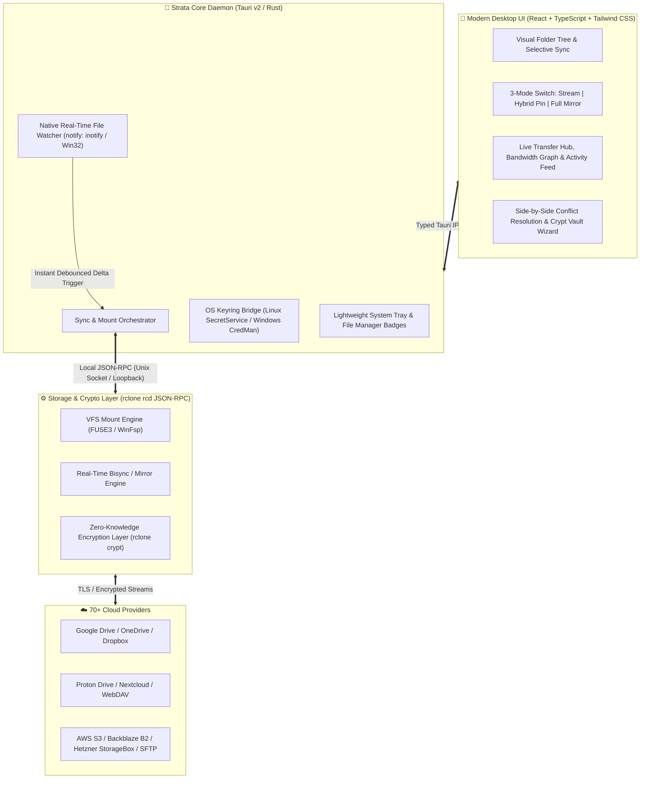

# ⚡ Strata

> **The modern, open-source cloud sync & virtual drive client for Linux and Windows.**  
> Combining the multi-cloud power and encryption of **rclone** with the intuitive real-time selective sync, mirroring, and desktop integration of **Insync** — built with **Tauri v2 (Rust)** and **React**.

---

## 🌟 Why Strata?

Power users on **Linux** and **Windows** have long faced a frustrating trade-off when managing cloud storage:
- **rclone** is an engineering masterpiece supporting **70+ cloud providers**, `crypt` zero-knowledge encryption, `bisync`, and `mount` — but lacks a modern, unified desktop GUI and real-time file-watcher out of the box.
- **Insync** offers great desktop usability (selective sync trees, arbitrary local folder mapping, ignore rules, conflict resolution), but is **closed-source, expensive (per-account licensing)**, limited to only 3 providers, and features a dated UI.

**Strata bridges both worlds:** a sleek, lightweight desktop application powered by a **Rust background daemon** and the **rclone engine**, designed from the ground up for flexibility, speed, and visual clarity.

---

## 🎛️ One Tool, Three Storage Modes

Strata never forces you into a single workflow. Every connected remote — or even individual subfolders — can operate in one of three modes:

### 1. ☁️ Lightweight Stream Mode (Virtual Drive / Mount)
Mount your cloud storage as a **native disk drive (`Z:` on Windows via WinFsp)** or **mount folder (`~/Cloud/...` on Linux via FUSE3)**.
- **Zero local disk footprint:** Browse terabytes of cloud files instantly in Windows Explorer, Dolphin, or Nautilus without downloading everything first.
- **Smart VFS Caching:** Files stream on demand when opened and cache locally with full offline write tolerance (`vfs-cache-mode full`).

### 2. 💾 Full Offline Mirror Mode (Real-Time Local Sync)
Need 100% physical offline availability on your SSD or NAS? Map any local directory or disk partition to any cloud folder with **instant real-time filesystem watching** (`inotify` / `ReadDirectoryChangesW`) and choose your exact mirror direction:
- 🔄 **Bi-Directional (`Local ↔ Cloud`):** Two-way real-time sync with visual conflict resolution.
- ⬆️ **Backup Mirror (`Local → Cloud`):** Mirror local drives to the cloud (with optional cloud archive/trash protection for deleted files).
- ⬇️ **Download Mirror (`Cloud → Local`):** Keep a local backup drive continuously updated from the cloud.

### 3. 📌 Hybrid Smart Pinning (Best of Both Worlds)
Have a **5 TB cloud drive** but only a **1 TB laptop SSD**?
- Mount the entire 5 TB cloud as a lightweight virtual drive so every file is visible at all times.
- Simply click the **📌 Pin ("Keep Offline")** badge on specific project folders in Strata's visual folder tree to keep those exact directories physically mirrored on disk for offline work on a plane or train.

---

## 🏛️ System Architecture

---

## 📊 Comparison Matrix

| Feature | **Strata** | **Insync** | **rclone (CLI)** | **Legacy rclone GUIs** |
| :--- | :---: | :---: | :---: | :---: |
| **License** | **Open Source (GPL-3.0)** | ❌ Proprietary (Paid per account) | ✅ Open Source (MIT) | ✅ Open Source |
| **Supported Providers** | **70+ (via rclone)** | ❌ Only 3 (GDrive, OneDrive, Dropbox) | ✅ 70+ | ✅ 70+ |
| **Modern UI / UX** | **✅ Linear / Raycast Style** | 🟡 Dated | ❌ CLI only | ❌ Outdated (Qt5/Web) |
| **Virtual Drive (Stream Mount)** | **✅ Native (`Z:` / FUSE3)** | ❌ No | ✅ Via CLI flags | 🟡 Basic |
| **Real-Time 2-Way & 1-Way Mirror** | **✅ Native OS File Watcher** | ✅ Yes | ❌ Manual / Cron | ❌ Manual / Cron |
| **Hybrid Smart Pinning** | **✅ Mount + Folder Pinning** | ❌ No | ❌ Manual | ❌ No |
| **1-Click Zero-Knowledge Encryption** | **✅ Built-in (`rclone crypt`)** | ❌ No | ✅ Manual CLI setup | ❌ Complex |
| **Memory Footprint (Background)** | **~15–40 MB (Rust / Tauri v2)** | ~150–300 MB (Python/Qt) | ~20 MB | Varies |

---

## 🗺️ Project Roadmap

- [x] **Phase 0: Architecture Foundation & AI-First Repository Governance**
  - Comprehensive technical specifications (`architecture/00`–`04`), milestone roadmap, and automated pre-commit security guardrails.
- [ ] **Phase 1: Core Workspace & Modern UI Prototype**
  - Tauri v2 (Rust + React/TypeScript + Tailwind CSS) monorepo setup, responsive workspace layout, 3-mode storage switcher, interactive folder tree, and live transfer drawer.
- [ ] **Phase 2: Rclone Engine Bridge & Zero-Knowledge Onboarding**
  - Managed `rclone rcd` JSON-RPC daemon in Rust, OS Keyring credential encryption, OAuth provider wizard, and 1-click `rclone crypt` vault setup.
- [ ] **Phase 3: Virtual Drive (Lightweight Stream Mode)**
  - Cross-platform mount orchestration (`FUSE3` on Linux, `WinFsp` drive letters & folders on Windows) with configurable VFS caching and live cache telemetry.
- [ ] **Phase 4: Real-Time Mirroring & Hybrid Smart Pinning**
  - Native OS file watcher (`notify`), debounced incremental sync (`Local ↔ Cloud`, `Local → Cloud`, `Cloud → Local`), per-folder offline pinning inside mounts, ignore rules (`.strataignore`), and visual conflict resolution.
- [ ] **Phase 5: Desktop Integration & Cross-Platform Packaging (`v1.0`)**
  - System tray quick-menu, native notifications, file manager status badges, and official installers for Linux (`.deb`, `.rpm`, `AppImage`, `Flatpak`) and Windows (`.msi`, `NSIS .exe`).

---

## 📂 Repository Navigation

- **Architecture & Engineering Specs:** [`architecture/`](./architecture/)
  - [`00-product-vision.md`](./architecture/00-product-vision.md) – Core product philosophy & 3-layer storage model
  - [`01-tech-stack-and-monorepo.md`](./architecture/01-tech-stack-and-monorepo.md) – Tauri v2, Rust backend, React/Tailwind UI & IPC design
  - [`02-rclone-engine-and-vfs-architecture.md`](./architecture/02-rclone-engine-and-vfs-architecture.md) – `rclone rcd` daemon management, VFS cache, FUSE3 & WinFsp
  - [`03-sync-and-mirror-modes.md`](./architecture/03-sync-and-mirror-modes.md) – Stream Mount, Full Offline Mirror, Hybrid Pinning & real-time file watcher
  - [`04-security-and-zero-knowledge.md`](./architecture/04-security-and-zero-knowledge.md) – OS Keyring integration & `rclone crypt` zero-knowledge encryption
- **Project Memory & Roadmap:** [`memory/`](./memory/)
  - [`PROJECT_STATE.md`](./memory/PROJECT_STATE.md) – Live module status matrix
  - [`MILESTONES.md`](./memory/MILESTONES.md) – Detailed phase-by-phase engineering checklist
  - [`BLACKBOX.md`](./memory/BLACKBOX.md) – Chronological engineering log & Architecture Decision Records (ADRs)
- **Developer & AI Governance:** [`AGENTS.md`](./AGENTS.md) & [`CONTRIBUTING.md`](./CONTRIBUTING.md)

---

## 🤝 Contributing & License

Contributions, feature discussions, and architecture feedback are welcome! Please read [`CONTRIBUTING.md`](./CONTRIBUTING.md) before submitting a pull request.

**Strata** is free and open-source software licensed under the **[GNU General Public License v3.0 (GPL-3.0)](./LICENSE)**.  
Copyright © 2026 **SolidStateNetwork** and Strata Contributors.
