# 🌟 00 – Product Vision: Strata („Best of rclone & Insync“)

## 1. Ausgangslage & Problemstellung

Auf Linux und Windows existiert eine deutliche Lücke im Bereich Cloud-Synchronisation und Cloud-Mounting:
1. **`rclone` (CLI):** Unterstützt über 70 Cloud-Provider, bietet extrem stabiles VFS-Mounting (`rclone mount`), bidirektionale Synchronisation (`rclone bisync`) und starke Client-seitige Verschlüsselung (`rclone crypt`). Allerdings fehlt eine moderne Desktop-Oberfläche, ein integrierter Echtzeit-Dateisystem-Watcher (`inotify` / `ReadDirectoryChangesW`) sowie eine visuelle Konfliktlösung.
2. **Insync (Proprietär):** Bietet hervorragende Desktop-Workflows (Selektiver Sync per Ordnerbaum, beliebige lokale Ordner-Mappings, Ignore-Regeln, Activity-Feed), ist jedoch **Closed-Source**, teuer (Lizenzmodell pro Account), unterstützt nur 3 Cloud-Anbieter (Google Drive, OneDrive, Dropbox) und besitzt eine optisch veraltete Benutzeroberfläche sowie keinen echten „Lightweight Virtual Drive (0 GB lokal)“-Modus für beliebige Clouds.

---

## 2. Die Vision von Strata

**Strata** vereint die unerreichte Multi-Cloud- & Krypto-Power von `rclone` mit dem Bedienkomfort von *Insync* und der flexiblen Speicher-Architektur von *Google Drive for Desktop (Stream vs. Mirror)* in einer modernen, ressourcenschonenden Open-Source-App (**GPL-3.0**) für **Windows und Linux**.

```mermaid
flowchart LR
    subgraph Layer1["☁️ Schicht 1: Cloud Provider Layer (70+ Clouds)"]
        C1["Google Drive / OneDrive / Dropbox"]
        C2["Proton Drive / Nextcloud / WebDAV"]
        C3["AWS S3 / Backblaze B2 / Hetzner StorageBox"]
    end

    subgraph Layer2["🔐 Schicht 2: Strata Engine & Crypto Layer"]
        Crypt["Optionaler Zero-Knowledge Layer\n(rclone crypt)"]
        VFS["Intelligenter VFS-Cache & Bisync-Orchestrator\n(Rust Daemon + rclone rcd)"]
    end

    subgraph Layer3["💻 Schicht 3: Local & Virtual Filesystem Layer"]
        M1["☁️ Stream Mode\n(Virtuelles Laufwerk Z: / FUSE3 – 0 GB lokal)"]
        M2["📌 Hybrid Smart Pinning\n(Virtueller Mount + Ausgewählte Ordner lokal gepinnt)"]
        M3["💾 Full Offline Mirror\n(100 % lokal auf Disk: 2-Way, Backup oder Download)"]
    end

    Layer1 <==> Layer2 <==> Layer3
```

---

## 3. Die 5 Kern-Versprechen (Core Pillars)

1. **Freie Wahl zwischen Lightweight-Stream & Full-Offline-Mirror:**
   - **Lightweight-User** binden ihre Terabyte-Cloud als virtuelles Laufwerk (`Z:` unter Windows, `~/Cloud/...` unter Linux) ein und verbrauchen lokal keinen Festplattenspeicher.
   - **Offline-Power-User** spiegeln ihre Daten physisch auf beliebige lokale Festplatten oder Ordner (`2-Way Sync`, `Lokal → Cloud Backup` oder `Cloud → Lokal Download`).
   - **Hybrid-User** kombinieren beides: Die gesamte Cloud ist als virtuelles Laufwerk sichtbar, während wichtige Projektordner per **📌 Pin („Offline verfügbar halten“)** physisch auf der lokalen SSD synchronisiert werden.
2. **Echtzeit statt starrer Cronjobs:**
   - Lokale Änderungen werden über native Betriebssystem-Events (`inotify` auf Linux, `ReadDirectoryChangesW` auf Windows) sofort erkannt und gebündelt (Debouncing) an die Sync-Engine übergeben.
3. **Modernes UI/UX („Linear / Raycast“-Ästhetik):**
   - Keine verschachtelten Einstellungsfenster aus den 2000ern. Klare Typografie, flüssige Animationen, Dark/Light-Mode, Echtzeit-Bandbreiten-Graphen und ein übersichtlicher Activity-Feed.
4. **Zero-Knowledge Encryption per Klick:**
   - Jeder Ordner oder jedes Remote kann per einfachem Toggle-Switch im UI clientseitig Ende-zu-Ende verschlüsselt werden (`rclone crypt`), ohne dass der Nutzer kryptografische CLI-Parameter kennen muss.
5. **Minimaler Ressourcenverbrauch im Hintergrund:**
   - Durch **Tauri v2 + Rust** benötigt der Hintergrund-Daemon im System-Tray nur wenige Megabyte RAM, wenn das Hauptfenster geschlossen ist.
