# 🌟 00 — Product Vision: Strata ("Best of rclone & Insync")

## 1. Background & Problem Statement

On Linux and Windows, power users face a major gap in cloud synchronization and virtual drive mounting:
1. **`rclone` (CLI):** Supports 70+ cloud providers, offers rock-solid VFS mounting (`rclone mount`), bidirectional synchronization (`rclone bisync`), and strong client-side encryption (`rclone crypt`). However, it lacks a modern native desktop interface, a built-in real-time filesystem watcher (`inotify` / `ReadDirectoryChangesW`), and visual conflict resolution.
2. **Insync (Proprietary):** Provides great desktop workflows (selective sync folder trees, arbitrary local folder mappings, ignore rules, activity feeds), but is **closed-source**, expensive (per-account licensing), limited to only 3 cloud providers (Google Drive, OneDrive, Dropbox), features a dated user interface, and lacks a true "Lightweight Virtual Drive (0 GB local)" stream mode across arbitrary clouds.

---

## 2. The Strata Vision

**Strata** combines the unmatched multi-cloud and cryptographic power of `rclone` with the desktop usability of *Insync* and the flexible storage architecture of *Google Drive for Desktop (Stream vs. Mirror)* inside a modern, lightweight open-source application (**GPL-3.0**) for **Windows and Linux**.

```mermaid
flowchart LR
    subgraph Layer1["☁️ Layer 1: Cloud Provider Layer (70+ Clouds)"]
        C1["Google Drive / OneDrive / Dropbox"]
        C2["Proton Drive / Nextcloud / WebDAV"]
        C3["AWS S3 / Backblaze B2 / Hetzner StorageBox"]
    end

    subgraph Layer2["🔐 Layer 2: Strata Engine & Crypto Layer"]
        Crypt["Optional Zero-Knowledge Layer\n(rclone crypt)"]
        VFS["Smart VFS Cache & Bisync Orchestrator\n(Rust Daemon + rclone rcd)"]
    end

    subgraph Layer3["💻 Layer 3: Local & Virtual Filesystem Layer"]
        M1["☁️ Stream Mode\n(Virtual Drive Z: / FUSE3 — 0 GB local)"]
        M2["📌 Hybrid Smart Pinning\n(Virtual Mount + Selected Folders Pinned Offline)"]
        M3["💾 Full Offline Mirror\n(100% Local on Disk: 2-Way, Backup, or Download)"]
    end

    Layer1 <==> Layer2 <==> Layer3
```

---

## 3. Core Pillars

1. **Free Choice Between Lightweight Stream & Full Offline Mirror:**
   - **Lightweight Users** mount terabyte-scale cloud remotes as a virtual drive (`Z:` on Windows, `~/Cloud/...` on Linux) without consuming permanent local disk space.
   - **Offline Power Users** physically mirror their data onto arbitrary local drives or folders (`2-Way Sync`, `Local → Cloud Backup`, or `Cloud → Local Download`).
   - **Hybrid Users** combine both: the entire cloud remains visible as a virtual drive while critical project directories are pinned via **📌 Pin ("Keep Offline")** and physically synchronized on the local SSD.
2. **Real-Time Events Instead of Rigid Cron Jobs:**
   - Local file changes are detected immediately via native operating system events (`inotify` on Linux, `ReadDirectoryChangesW` on Windows) and delivered to the sync engine through a smart debouncer.
3. **Modern UI/UX ("Linear / Raycast" Aesthetic):**
   - No cluttered 2000s-era settings dialogs. Crisp typography, smooth transitions, dark/light themes, real-time bandwidth sparklines, and an actionable activity hub.
4. **1-Click Zero-Knowledge Encryption:**
   - Any folder or remote can be end-to-end encrypted client-side (`rclone crypt`) via a simple UI toggle without requiring users to memorize cryptographic CLI flags.
5. **Minimal Background Resource Footprint:**
   - Powered by **Tauri v2 + Rust**, the background system-tray daemon consumes only a few megabytes of RAM when the main cockpit window is closed.
