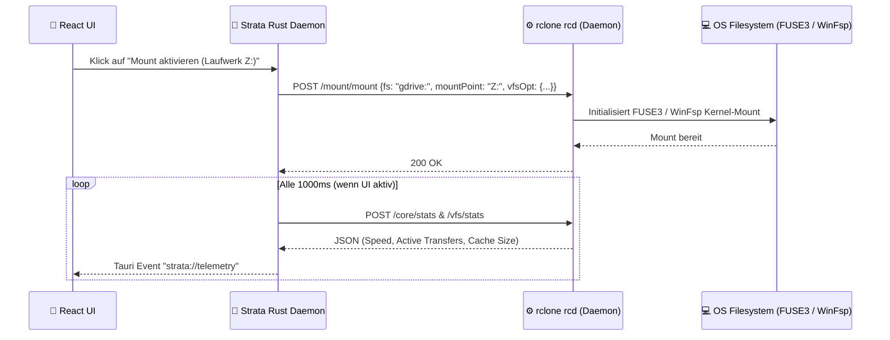

# ⚙️ 02 – Rclone Engine Bridge & VFS Mount Architecture

## 1. Warum `rclone rcd` (JSON-RPC) statt einzelner CLI-Aufrufe?

Klassische rclone-Wrapper starten für jede Aktion einen neuen `rclone`-Subprozess und parsen Text-Logs von `stdout`. Das ist langsam, fehleranfällig und erlaubt keine saubere Echtzeit-Steuerung.

**Strata nutzt einen persistenten, vom Rust-Daemon verwalteten `rclone rcd` (Remote Control Daemon):**
- Beim Start von Strata startet der Rust-Core im Hintergrund eine dedizierte `rclone rcd`-Instanz, die ausschließlich lokal gebunden ist:
  - **Linux:** Unix Domain Socket (`$XDG_RUNTIME_DIR/strata/rclone.sock`, `chmod 0600`) oder Loopback mit zufälligem Session-Token.
  - **Windows:** Authentifizierter Loopback-Endpunkt (`127.0.0.1:<ephemeral-port>`) mit zufällig generiertem 256-Bit Basic-Auth/Bearer-Token pro Start.
- Alle Operationen (Auflisten von Ordnern, Starten/Stoppen von Mounts, Kopieren, Synchronisieren, Bandbreiten-Limits, Abrufen von Live-Transfer-Statistiken) laufen über **typisierte JSON-RPC-Aufrufe** (`core/stats`, `vfs/stats`, `sync/bisync`, `sync/copy`, `mount/mount`, `config/create`).

---

## 2. Binary-Strategie (Bundled Sidecar + System-Fallback)

1. **System-Erkennung & Bundled Sidecar:**
   - Strata prüft beim Start, ob eine kompatible `rclone`-Version (`>= 1.68.0`) im System installiert ist oder nutzt die mitgelieferte Tauri-Sidecar-Binary.
   - Im Einstellungsmenü wird die aktive `rclone`-Version transparent angezeigt und kann bei Bedarf aktualisiert werden.
2. **Plattform-Treiber für Virtual Drive (Mount-Modus):**
   - **Linux:** Nutzt `libfuse3` (`/usr/bin/fusermount3`). Strata prüft beim Onboarding automatisch, ob `fuse3` vorhanden ist, und zeigt andernfalls einen klaren 1-Klick-Installationshinweis für die jeweilige Distribution (Debian/Ubuntu, Fedora, Arch).
   - **Windows:** Nutzt **WinFsp** (*Windows File System Proxy*). Der Windows-Installer von Strata prüft, ob WinFsp installiert ist, und bietet die direkte Mitinstallation an. Dadurch können Cloud-Speicher unter Windows sowohl als **echter Laufwerksbuchstabe (`Z:`, `X:`)** als auch als **Ordnerpfad (`C:\Users\<Name>\Cloud\...`)** eingebunden werden.

---

## 3. Intelligentes VFS-Cache-Management

Damit sich ein gemountetes Cloud-Laufwerk so schnell und zuverlässig anfühlt wie eine lokale SSD, konfiguriert Strata das rclone Virtual File System (`VFS`) nach Best-Practice-Profilen:

| Profil | `vfs-cache-mode` | Beschreibung | Ideal für |
| :--- | :---: | :--- | :--- |
| **Smart Balanced (Standard)** | `full` | Liest und schreibt über einen lokalen Sparse-File-Cache mit Größenlimit (`vfs-cache-max-size`, z. B. 20 GB) und Alterslimit (`vfs-cache-max-age`). Erlaubt volles Bearbeiten von Dateien (Office, Video, Code) direkt auf dem Cloud-Mount. | Alltag, Office, Medien, Offline-Pufferung |
| **Ultra Lightweight** | `writes` | Nur geänderte/neu geschriebene Dateien werden bis zum Upload kurz zwischengespeichert; reine Lesezugriffe werden direkt aus dem RAM gestreamt. | Laptops mit extrem wenig freiem SSD-Speicher |
| **Zero-Disk Stream** | `off` / `minimal` | Fast gar kein lokaler Festplatten-Cache; direktes Streaming aus der Cloud. | Reine Medien-Wiedergabe auf großen Archiven |

Über den Endpunkt `vfs/stats` und `vfs/forget` zeigt Strata im UI jederzeit an, wie viel Speicherplatz der VFS-Cache aktuell belegt, und bietet einen **„Cache jetzt leeren“-Button** (solange keine nicht-hochgeladenen Änderungen ausstehen).
