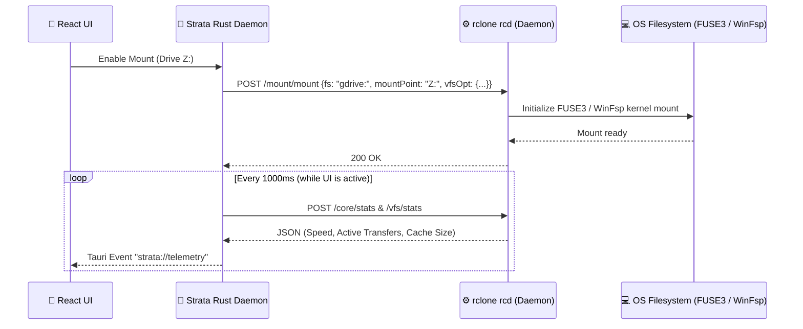

# ⚙️ 02 — Rclone Engine Bridge & VFS Mount Architecture

## 1. Why `rclone rcd` (JSON-RPC) Instead of Ad-Hoc CLI Subprocesses?

Traditional `rclone` wrappers spawn a fresh `rclone` CLI subprocess for every operation and parse unstructured text logs from `stdout`. That approach is slow, fragile, and incapable of smooth real-time control.

**Strata runs a persistent `rclone rcd` (Remote Control Daemon) managed by the Rust core:**
- On startup, the Rust daemon launches a dedicated background `rclone rcd` process bound strictly to the local machine:
  - **Linux:** Unix domain socket (`$XDG_RUNTIME_DIR/strata/rc.sock`, `chmod 0600`) or authenticated loopback with an ephemeral session token.
  - **Windows:** Authenticated loopback endpoint (`127.0.0.1:<ephemeral-port>`) protected by a randomly generated 256-bit per-session bearer/basic-auth token.
- All operations (listing directories, mounting/unmounting drives, copying, bidirectional syncing, bandwidth limiting, querying live transfer telemetry) execute via **typed JSON-RPC calls** (`core/stats`, `vfs/stats`, `sync/bisync`, `sync/copy`, `mount/mount`, `config/create`).

---

## 2. Binary Strategy (Bundled Sidecar + System Fallback)

1. **System Detection & Bundled Sidecar:**
   - On startup, Strata checks whether a compatible `rclone` binary (`>= 1.68.0`) is installed on the host system or falls back to the bundled Tauri sidecar binary.
   - The active `rclone` version and transport endpoint are displayed transparently in the UI.
2. **Platform Drivers for Virtual Drive (Mount Mode):**
   - **Linux:** Uses `libfuse3` (`/usr/bin/fusermount3`). Strata automatically probes for `fusermount3` and provides distribution-specific installation guidance (Debian/Ubuntu, Fedora, Arch) if missing.
   - **Windows:** Uses **WinFsp** (*Windows File System Proxy*). This allows cloud remotes on Windows to be mounted either as a **native drive letter (`Z:`, `X:`)** or as a **directory path (`C:\Users\<User>\Cloud\...`)**.

---

## 3. Intelligent VFS Cache Management

To make a mounted cloud drive feel as fast and reliable as a local SSD, Strata configures the rclone Virtual File System (`VFS`) using three curated profiles:

| Profile | `vfs-cache-mode` | Behavior | Ideal Use Case |
| :--- | :---: | :--- | :--- |
| **Smart Balanced (Default)** | `full` | Reads and writes through a local sparse-file cache with configurable size quota (`vfs-cache-max-size`, e.g., 25 GB) and age limit (`vfs-cache-max-age`). Enables full random-access editing (Office, video, code) directly on the cloud mount. | Everyday productivity, media editing, resilient offline buffering |
| **Ultra Lightweight** | `writes` | Only modified or newly written files are buffered locally until upload completes; read operations stream directly in memory. | Laptops with very limited free SSD space |
| **Zero-Disk Stream** | `minimal` | Virtually zero local disk cache; streams directly from the cloud remote. | Pure media playback from large cold archives |

Via the `vfs/stats` and `vfs/forget` endpoints, Strata displays live VFS cache occupancy in the Inspector Drawer and provides a **1-Click "Purge Local VFS Cache"** action whenever no dirty writeback buffers are pending.
