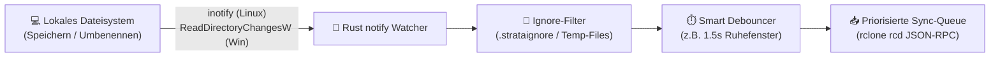

# 🔄 03 – Sync-, Mirror- & Hybrid-Pinning-Architektur

## 1. Übersicht der 3 Betriebsmodi

Strata unterstützt für jedes verbundene Cloud-Remote drei klar definierte Betriebsmodi, die im UI jederzeit umgeschaltet oder pro Ordner kombiniert werden können:

| Modus | Lokaler Speicherbedarf | Funktionsweise | Primärer Einsatzzweck |
| :--- | :--- | :--- | :--- |
| **1. ☁️ Virtual Stream (Mount)** | **0 GB** *(+ optionaler VFS-Cache)* | Bindet die Cloud als Laufwerksbuchstabe (`Z:`) oder Mount-Ordner (`~/Cloud/...`) ein. Dateien werden erst beim Öffnen gestreamt. | Große Cloud-Speicher (1–20 TB) auf Laptops mit kleiner SSD. |
| **2. 💾 Full Offline Mirror** | **100 %** der gewählten Ordner | Physischer Ordner auf einer lokalen Festplatte/Partition, der in Echtzeit mit der Cloud synchronisiert wird. | Volle Offline-Arbeit, maximale lokale I/O-Performance, lokale Backups. |
| **3. 📌 Hybrid Smart Pinning** | **Nur gepinnte Ordner (100 %)**, Rest **0 GB** | Die gesamte Cloud ist als Virtual Mount sichtbar, aber markierte („gepinnte“) Ordner werden zusätzlich physisch für den Offline-Zugriff synchronisiert. | Best of Both Worlds: Alles sehen, aber nur aktuelle Projekte lokal speichern. |

---

## 2. Alle Spiegel-Richtungen im „Full Offline Mirror“-Modus

Im Gegensatz zu herkömmlichen Cloud-Clients bietet Strata im Spiegel-Modus **drei frei wählbare Spiegel-Richtungen** pro Ordner-Paar (`Mapping`):

### A. 🔄 Bi-Direktional (`Lokal ↔ Cloud` / 2-Way Sync)
- **Verhalten:** Änderungen, neue Dateien, Umbenennungen und Löschungen werden auf beiden Seiten abgeglichen (analog zu Insync/Dropbox).
- **Technik:** Nutzt eine vom Rust-Daemon orchestrierte Kombination aus:
  1. **Echtzeit-Delta-Sync** bei lokalen Dateiänderungen (über den Rust `notify`-Filewatcher).
  2. **Periodischem Remote-Change-Polling / Change-Notify** (`rclone bisync` / Drive Changes API), um Änderungen aus der Cloud abzurufen.
- **Konfliktschutz:** Wird eine Datei gleichzeitig lokal und in der Cloud geändert, überschreibt Strata **niemals** stillschweigend Daten. Stattdessen wird eine Konflikt-Kopie angelegt und im **Visuellen Konflikt-Manager** zur Auswahl (Lokal behalten / Cloud behalten / Beide behalten) angezeigt.

### B. ⬆️ Backup-Spiegel (`Lokal → Cloud` / 1-Way Upload Mirror)
- **Verhalten:** Der lokale Ordner (oder eine lokale Festplatte) ist die führende Quelle (*Single Source of Truth*). Alle lokalen Änderungen werden in die Cloud gespiegelt.
- **Sicherheits-Option „Soft-Delete / Cloud-Archiv“:** Der Nutzer kann wählen:
  - *Strikter Spiegel (`sync`):* Lokal gelöschte Dateien werden auch in der Cloud gelöscht.
  - *Geschützter Backup-Spiegel (`sync --backup-dir`):* Lokal gelöschte oder überschriebene Dateien werden in der Cloud nicht gelöscht, sondern automatisch mit Zeitstempel in einen Ordner `.strata-archive/YYYY-MM-DD/` verschoben (Schutz vor versehentlichem Löschen oder Ransomware!).
  - *Reines Hinzufügen (`copy`):* Neue und geänderte Dateien werden hochgeladen, Löschungen werden in der Cloud komplett ignoriert.

### C. ⬇️ Download-Spiegel (`Cloud → Lokal` / 1-Way Download Mirror)
- **Verhalten:** Die Cloud ist die führende Quelle und wird 1:1 auf einen lokalen Ordner oder ein lokales Backup-Laufwerk/NAS heruntergeladen.
- **Einsatzgebiet:** Lokales Offline-Backup eines Cloud-Speichers (z. B. Google Drive oder Nextcloud automatisch auf eine lokale externe Festplatte spiegeln).

---

## 3. Echtzeit-File-Watcher & Debouncing-Pipeline (Rust `notify`)

Damit lokale Dateiänderungen wie bei *Insync* sofort in der Cloud landen (ohne jede Sekunde unnötige API-Requests zu feuern), arbeitet im Rust-Backend eine mehrstufige Pipeline:

1. **Ignore-Filterung vorab:** Temporäre Editor-Dateien (`*.swp`, `~$*.docx`, `.DS_Store`, `Thumbs.db`, `node_modules/`, `.git/` falls gewünscht) werden direkt im Rust-Watcher anhand einer konfigurierbaren `.strataignore`-Regelliste ausgefiltert.
2. **Smart Debouncing:** Wenn ein Programm (z. B. IDE oder Videoschnitt) innerhalb von 500 ms 40 Dateien speichert, wartet der Debouncer ein kurzes Ruhefenster (Standard: `1500 ms`, maximal `10 s` Batch-Delay) ab und übergibt den Vorgang als effizienten Batch-Job an `rclone rcd`.

---

## 4. Funktionsweise von „Hybrid Smart Pinning“

Wie kombiniert Strata einen **0-GB-Cloud-Mount** mit **100-%-Offline-Ordnern**?
1. Das Cloud-Remote wird über das VFS gemountet.
2. Markiert der Nutzer im Strata-Explorer einen Unterordner mit **📌 Pin („Immer offline verfügbar“)**, hält der Strata-Daemon diesen Teilbaum über einen lokalen Spiegel-Pfad bzw. VFS-Pinning-Job permanent im lokalen Speicher vor und synchronisiert Änderungen bidirektional.
3. Selbst wenn die Internetverbindung abbricht, sind alle gepinnten Ordner sofort zu 100 % lokal auf der Festplatte les- und beschreibbar; sobald die Verbindung zurückkehrt, synchronisiert der Daemon die Deltas automatisch in die Cloud.
